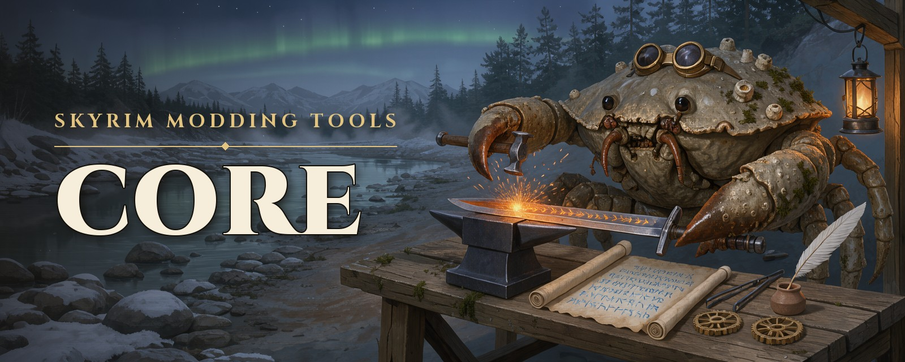
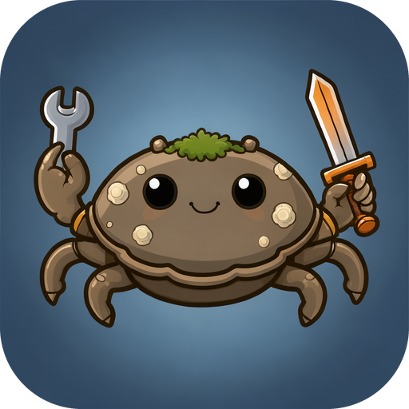

<p align="center">
  
</p>

<p align="center">
  <a href="https://github.com/Ciltress/skyrim-modding-tools-core/actions/workflows/ci.yml"></a>
  <a href="https://github.com/Ciltress/skyrim-modding-tools-core/tags"></a>
  <a href="LICENSE"></a>
  
</p>

# skyrim-modding-tools-core

**Skyrim Special Edition modding as tools a program — or an AI agent — can call.** Look up any record across your
whole load order, write mods as plain text and build them into real plugins, install mods from Nexus Mods, and find
out why the game crashed. On Mod Organizer 2 (Windows) or Amethyst Mod Manager (Linux).

This is the engine of the Skyrim Modding Tools. Use it from your own code, or take one of the ready-made products:

| | |
| --- | --- |
| **[skyrim-modding-tools-mcp](https://github.com/Ciltress/skyrim-modding-tools-mcp)** | The MCP server, for Claude Code, Claude Desktop, VS Code and any other MCP client. One `npm run setup` and you are modding. |
| **[skyrim-modding-tools-openclaw-plugin](https://github.com/Ciltress/skyrim-modding-tools-openclaw-plugin)** | The same tools as a native [OpenClaw](https://openclaw.ai) plugin, made to work well with small local models. |
| **This package** | For your own program: a script, a bot, another agent framework. [See below](#use-it-in-your-own-program). |

## What it does

- 🔍 **Look it up.** Any record by name, editor ID or FormID, across the whole load order: which mod adds it, which
  one wins, who else changes it. Read it as text, or every mod's version side by side.
- ✍️ **Mods as text.** A mod is a folder of YAML files, one per record, in [Spriggit](https://github.com/Mutagen-Modding/Spriggit)'s
  format: easy to read, to diff and to keep in git. The build checks every link, gives new records their FormIDs,
  compiles Papyrus scripts and writes the plugin — then reads it back and tells you what it holds.
- 🩹 **Patch without touching.** Copy another mod's record into your patch and change it there; the original mod
  stays as it is.
- 📦 **Install mods.** Search Nexus Mods, read a mod's page and what it requires, download, install with its FOMOD
  installer answered, enable or disable, and check SKSE plugins against your game version.
- 💥 **Read crash logs.** Crash Logger SSE's logs against 105 known crashes, with the mod behind every DLL, mesh,
  texture and record the log names.
- 📚 **Teach the agent.** Skills for items and crafting, magic, NPCs, leveled lists, game updates and crash analysis,
  and guides to which tool does what — the knowledge a model needs to mod well.

The Creation Kit stays for what only it can do, like placing objects and navmesh; its work is pulled back into the
text.

## Modding with Muddy! 🦀



Meet **Muddy**, the modding agent: a mudcrab from the shore below Riverwood who learned to mod Skyrim. Cheerful,
proud of his shell, and exact at the workbench. He reads the skills before he writes a record, builds until the build
says `success`, and leaves your mod manager alone unless you ask.

He lives here, in [`agents/muddy`](agents/muddy): his soul, his identity, his working rules and his avatar. Every
product sets up the same Muddy:

- **OpenClaw:** `openclaw skyrim setup`, the [plugin's](https://github.com/Ciltress/skyrim-modding-tools-openclaw-plugin#modding-with-muddy-)
  wizard, makes him an agent. It asks for his model, his context and how long he thinks, and gives him his tools and skills.
- **Claude Code, Claude Desktop, VS Code, ChatGPT or any other MCP client:** the [MCP server's guide to Muddy](https://github.com/Ciltress/skyrim-modding-tools-mcp/blob/main/docs/Muddy.md).
- **The simplest way:** copy `AGENTS.md` and `SOUL.md` from [`agents/muddy`](agents/muddy) into the folder your agent
  works in.
- **Your own program:** `MUDDY` (his name, emoji and avatar), `muddyPrompt()` (his instructions as one text) and
  `writeMuddyWorkspace(folder)` (his files in a workspace).

## Use it in your own program

You need **Node.js 24.18** or later, the **.NET 10 SDK** (it builds the plugin helper, which reads and writes
plugins with [Mutagen](https://github.com/Mutagen-Modding/Mutagen)), and Skyrim Special Edition in Mod Organizer 2 or
Amethyst.

```bash
npm install github:Ciltress/skyrim-modding-tools-core#v0.2.10
npm --prefix node_modules/skyrim-modding-tools-core run build:helper
```

Every tool is one call away:

```js
import { CORE_GUIDES, createBackend, createHandlers, stopBackends } from 'skyrim-modding-tools-core';

// Your program, as the tools know it: Nexus Mods is told its name and version, and its folder holds the projects.
const product = { name: 'my-skyrim-app', version: '1.0.0', root: process.cwd(), guides: Object.values(CORE_GUIDES) };

const backend = createBackend({ ...process.env, SKYRIM_MO2_INSTANCE: 'C:/Modding/SkyrimSE' }, { product });
const tools = createHandlers(backend, product);

async function call(name, args) {
    const handler = tools.find(handler => handler.getTools().some(tool => tool.name === name));
    const answer = await handler.handle(name, args);
    return JSON.parse(answer.content[0].text);
}

console.log(await call('findRecords', { text: 'iron sword', limit: 3 }));
stopBackends();
```

Each tool comes with a name, a description and a JSON Schema for its arguments (`handler.getTools()`): hand them to
any model's function calling, and it can mod. The tools `readSkill` and `readServerGuide` teach it how.

The settings are environment variables. On Linux, Amethyst is found by itself; with Mod Organizer,
`SKYRIM_MO2_INSTANCE` names the instance folder. Searching Nexus Mods needs no key; `NEXUS_API_KEY`, a
premium account's personal key, adds downloading from it, and
`SKYRIM_PROJECTS_DIR` says where the projects go. Every other setting: the
[MCP server's table](https://github.com/Ciltress/skyrim-modding-tools-mcp#configuration).

**Try it on a test instance first.** Deploying and installing write into the instance's mods and profile. A portable
Mod Organizer on a clean game is the safe place to learn the tools.

## Documentation

| Document | For |
| --- | --- |
| [`docs/Tool-Router.md`](docs/Tool-Router.md) | Which tool does what, in the words people use |
| [`docs/MCP-Tools.md`](docs/MCP-Tools.md) | How the tools behave: rules, workflows, errors, troubleshooting |
| [`skills/`](skills) | The modding knowledge served to agents |
| [`CONTEXT.md`](CONTEXT.md) | The vocabulary |
| [`AGENTS.md`](AGENTS.md) | Working on this code: the layout and the conventions |

## Development

```bash
npm install            # also builds dist/
npm run build:helper   # the C# plugin helper, into helper/bin
npm test
```

## License and thanks

GPL-3.0-only, as [Mutagen](https://github.com/Mutagen-Modding/Mutagen), which reads and writes the plugins, is
GPL-3.0. The project text is [Spriggit](https://github.com/Mutagen-Modding/Spriggit)'s format.

The crash rules `readCrashLog` applies are Phostwood's [Skyrim Crash Log Analyzer](https://github.com/Phostwood/crash-analyzer)'s
(GPL-3.0), rewritten in TypeScript. Thanks to Phostwood for years of collecting them. Details in
[THIRD_PARTY_NOTICES.md](THIRD_PARTY_NOTICES.md).
